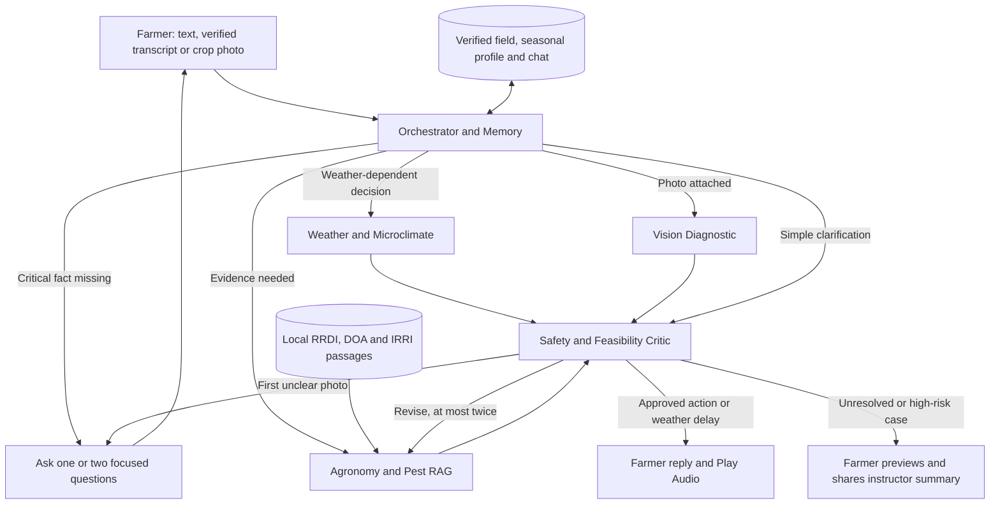

# PaddyGuard field workflow

## Polonnaruwa walkthrough

The farmer confirms Polonnaruwa, reports a 3.5-month Maha crop at day 40, attaches a leaf photo and asks in Tamil about spraying tomorrow. The specialists look up weather for the field, inspect the image and search local rice guidance. In the proposal fixture, 14 mm of rain and 85% rain probability conflict with the proposed spray. The critic withholds the spray and explains the delay. A brown-spot candidate remains tentative. A later dry window needs its own forecast check. An unclear image prompts a retake; a second unclear image goes to instructor review. Sharing is initiated by the farmer.

## November 20–29 implementation roadmap

| Planned dates | Work and checks |
| --- | --- |
| Nov 20–21 | Confirm field decisions, source editions, profile schema and expected outcomes. |
| Nov 22–23 | Build seasonal memory, manual ingestion, hybrid search and weather checks. |
| Nov 24–25 | Connect vision, five-agent routing, critic revisions and instructor handoff. |
| Nov 26–27 | Exercise phone onboarding, editable transcripts, spoken replies, repeat questions and language switches. |
| Nov 28–29 | Compare 30 cases using both AI workflows and timed human reviewers. Review failures and phone accessibility before release. |

## Evaluation and limits

Use project/eval/benchmark.py for the 30 fixed cases. Give the instructor the identical question, field profile, manual passages, weather and image observations, withhold expected answers, and record the decision and elapsed seconds per case. Score conflict detection, grounding and appropriate clarification, report referral precision and missed referrals, and compare mean and P95 latency. Record token use and model price separately for cost estimates. Human scores require actual reviewers.

Voice transcription is fallible, particularly for numbers. The farmer reviews the original-language transcript before sending. District forecasts describe representative coordinates. A variety-duration estimate cannot establish harvest readiness. Diagnosis and chemical rules need expert review. The app uses local agricultural evidence and retains no raw speech. Photos and field details are shared with model providers when submitted for analysis; referral sharing is a separate farmer action.

## Implementation and sources

FastAPI and SQLite serve the PWA. LangGraph coordinates the agents. ChromaDB supplies dense retrieval alongside keyword ranking. React and Tailwind implement the pinned farm bar and season dialog; the chat uses browser modules. The proposal specifies Gemini 2.5 Flash; the deployed model is configurable through GEMINI_MODEL. Open-Meteo supplies hourly weather. See the root README for setup, docs/Proposal.docx for the proposal, project/rag/sources.json for the official PDF editions, and project/rag/hybrid.py for additional RRDI references.
